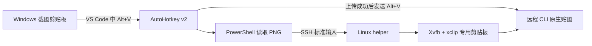

# SSH Image Paste

**Windows 截图 → SSH → Linux 剪贴板 → 远程 CLI 图片附件。**

[English](README.en.md) · [故障排查](docs/troubleshooting.md) · [工作原理与边界](docs/design.md) · [MIT License](LICENSE)

在 Windows 上按 `Win+Shift+S` 截图，回到 VS Code Remote-SSH 的 CLI 输入框，按 **Alt+V**。脚本先把截图传到服务器的专用 X11 剪贴板，再把 Alt+V 交给 CLI，使用它自己的图片附件功能。

## 解决什么问题？

Windows 的截图在**本机**剪贴板里，SSH 中运行的 CLI 读取的是**服务器**剪贴板。终端能粘贴文字，不代表它会把本机图片字节送到服务器。

无桌面的 Linux 服务器通常又没有 X11 剪贴板。因此，直接按粘贴键可能没有反应，或出现：

```text
Failed to paste image: clipboard unavailable
X11 server connection timed out because it was unreachable
```

本项目搭了一座桥：用 SSH 传 PNG，用服务器上的 Xvfb + xclip 提供虚拟剪贴板。**不需要服务器桌面、VNC、X11 网络转发或 systemd --user。**



## 适用范围

| 项目 | 要求或行为 |
|---|---|
| 本地 | Windows 10/11、Windows PowerShell 5.1、OpenSSH 客户端、AutoHotkey **v2** |
| 编辑器 | 默认正式版 VS Code；Insiders 可配置 `AppExe=Code - Insiders.exe` |
| 服务器 | Linux + Bash + Xvfb、xclip、xauth、xdpyinfo、timeout、flock、openssl |
| CLI | 默认要求它在 Linux 上支持 **Alt+V 从 X11 剪贴板贴图**；以实际 CLI 版本为准 |
| SSH | 已配置主机别名，能够免密登录，服务器指纹已经人工确认 |
| 权限 | 有依赖后，服务和配置均以普通用户身份运行；不依赖 sudo/systemd |

该方案来自实际远程 CLI 使用场景；作者环境已完成 Windows → Ubuntu 20.04 x86_64 的 PNG 完整性测试，最初工作流已由用户确认可用。公开版增加了 X11 认证与安装脚本，自动化测试独立验证其传输和剪贴板功能。**没有逐一验证所有 CLI/版本；不要把 Codex、agy、Claude Code 的快捷键视作完全相同。**

## 快速开始

### 1. 服务器：安装依赖与 helper

在 Linux 服务器上克隆仓库：

```bash
git clone https://github.com/IdKomorebi/ssh-image-paste.git
cd ssh-image-paste
```

Debian/Ubuntu 上，有管理员权限时安装依赖：

```bash
sudo apt-get install xvfb xclip xauth x11-utils util-linux openssl coreutils
```

没有 sudo？先检查是否已经有依赖：

```bash
command -v Xvfb xclip xauth xdpyinfo timeout flock openssl
```

如果只有 xclip 缺失、相关共享库已存在，可用官方 apt 软件源下载并提取到用户目录：

```bash
bash server/setup.sh --user-xclip --configure-shell
```

该选项不执行 sudo、不安装系统软件包；需要 `apt-get`、`dpkg-deb` 和可用的软件源元数据。如果 Xvfb 或其共享库也缺失，应让管理员安装依赖。本项目不捆绑第三方二进制，不承诺在完全缺失 X11 依赖的服务器上免权限安装全部组件。

依赖齐全时，正常安装：

```bash
bash server/setup.sh --display :99 --configure-shell
source ~/.config/ssh-image-paste/env.sh
~/.local/bin/ssh-image-paste-server --display :99 self-test
```

`self-test` 会用测试图片替换该显示号的剪贴板，并确认读回字节一致。

安装器创建用户专用 Xauthority 文件，启动只监听本机 Unix socket 的 Xvfb。`--configure-shell` 会备份 `.bashrc` 并追加环境加载行；不带此参数就不会修改 `.bashrc`。

**如果 `:99` 已被其他服务占用，选择一个空闲显示号，例如 `:100`，并在 Windows 配置中使用同一个值。安装器不会接管已有的非本项目显示服务。**

### 2. Windows：确认 SSH 别名与免密连接

在 `%USERPROFILE%\.ssh\config` 中使用你自己的配置，例如：

```sshconfig
Host myserver
    HostName server.example.com
    User your-user
    Port 22
    IdentityFile ~/.ssh/id_ed25519
    IdentitiesOnly yes
```

在 PowerShell 中确认：

```powershell
ssh myserver "echo ok"
```

首次连接时自己核对服务器指纹。配置好 SSH 密钥后，这条命令应不需要输入密码。脚本启用了 `BatchMode=yes` 和严格主机密钥检查，不会在后台等待密码或自动接受未知指纹。

### 3. Windows：安装 AutoHotkey v2、创建快捷方式

在 Windows 克隆仓库并进入目录：

```powershell
git clone https://github.com/IdKomorebi/ssh-image-paste.git
cd ssh-image-paste
winget install --id AutoHotkey.AutoHotkey --exact
powershell.exe -NoProfile -ExecutionPolicy Bypass -File .\windows\install.ps1 -HostName myserver -Display :99 -Start
```

这会创建未被 Git 跟踪的 `windows/config.ini`、桌面的 **SSH Image Paste** 快捷方式，并启动后台热键。`-ExecutionPolicy Bypass` 仅用于本次脚本进程，不修改系统执行策略。

启动后没有主界面，右下角系统托盘出现 **H** 图标，可能位于隐藏图标区。重复启动同一脚本只保留一个实例。重启 Windows 后再双击快捷方式；默认没有开机自启动。

也可以手动把 `windows/config.example.ini` 复制为 `windows/config.ini` 并修改。已有配置需重新生成时，显式给安装器添加 `-Force`。

### 4. 在远程终端加载环境，再启动 CLI

**这一步非常重要：已经运行的 CLI 不会自动获得后来新增的环境变量。**

在 VS Code Remote-SSH 的服务器终端执行：

```bash
source ~/.config/ssh-image-paste/env.sh
printf 'DISPLAY=%s\nXAUTHORITY=%s\n' "$DISPLAY" "$XAUTHORITY"
# 然后启动你自己的 CLI，例如 codex 或 agy。
```

如果 CLI 已经打开，先退出，加载环境后重新启动。tmux 中已存在的终端也要单独加载；只重启 Windows 的 H 不会改变远程进程的环境。

### 5. 截图 → Alt+V

1. `Win+Shift+S` 截图。
2. 回到目标远程 CLI 的输入框。
3. 按 **Alt+V**，等待上传完成，确认 CLI 显示图片附件后再提交提示词。

先连接服务器再启动 H，或先启动 H 再连接都可以。上传使用单独的 SSH 连接，不依赖 VS Code 连接的建立顺序，也不重复申请 SSH 配置中的端口转发。

## 配置与模式

```ini
[ssh-image-paste]
HostName=myserver
Mode=clipboard
Display=:99
RemoteHelper=~/.local/bin/ssh-image-paste-server
AppExe=Code.exe
```

- **clipboard（默认）**：上传到专用远程剪贴板，随后发送 CLI 原生 Alt+V。本机图片剪贴板保持不变。
- **path（可选）**：写入服务器 `~/.cache/ssh-image-paste/images/`，将绝对路径放入本机文字剪贴板后发送 Ctrl+V。终端与 CLI 是否把粘贴路径变成附件取决于其版本和 bracketed paste 支持；它不等于通用附件接口。

每个热键实例固定使用配置中的一个主机，不会自动识别 VS Code 当前连接的是哪台服务器。热键作用范围是目标 VS Code **窗口**，不自动识别终端/编辑器焦点；请在对应主机的 CLI 输入框使用。上传期间切换窗口会阻止后续自动发送按键。

其他显示号、其他安装位置与配置参数见脚本的 `-?` / `--help`。

## 排错与日常管理

```bash
~/.local/bin/ssh-image-paste-server --display :99 status
~/.local/bin/ssh-image-paste-server --display :99 ensure
~/.local/bin/ssh-image-paste-server --display :99 stop
```

- Windows 日志：`%LOCALAPPDATA%\ssh-image-paste\paste-image.log`。
- Xvfb 日志：`~/.local/state/ssh-image-paste/display-99/Xvfb.log`。
- 退出 H：右键托盘图标 → Exit。
- 改了配置后：退出/重启 H；改了远程环境后：重新启动目标 CLI。
- 安装器不创建 systemd 服务。重启服务器后，加载 env.sh 或下一次图片上传会尝试拉起服务。

详见 [故障排查](docs/troubleshooting.md)，特别是 `DISPLAY`、`XAUTHORITY` 与旧终端环境问题。

## 图片与资源

只在目标窗口中按 Alt+V 且本机剪贴板含图片时上传，不轮询、不持续截图。PNG 经现有 SSH 加密连接传输；X11 不监听 TCP，认证文件为当前用户私有。Windows 临时 PNG 与远程传输临时文件会清理；clipboard 模式下最后一张图片由 xclip 保持，替换图片或停止显示服务后失效；path 模式的文件保留在个人缓存目录，需要自行清理。

同一显示号中的多个 CLI 共享“最后一张图片”。它不是每个会话独立的历史库，也不隔离同一 Linux 账户下的其他程序。

最初本地热键脚本待机采样约 10 秒，CPU 为 0.00%、工作集约 15.8 MiB；这只是单次参考。上传时会短暂启动 PowerShell/SSH，服务器另有 Xvfb/xclip 开销。

## 测试与开发

```powershell
powershell.exe -NoProfile -ExecutionPolicy Bypass -File .\tests\windows-smoke.ps1
```

```bash
# 在有依赖且 :199 空闲的 Linux 上；不修改 .bashrc 或生产显示号。
bash tests/server-smoke.sh
```

包含 Windows 二进制传输和参数边界测试，以及 Linux 安装、并发启动、PNG 读回、非法输入、权限、X11 认证、显示冲突和重启测试。GitHub Actions 运行相同检查。

服务器 helper 安装完成后，还可以在空闲的测试显示号上验证完整 SSH 往返；它只生成合成图片，不读取本机剪贴板，会覆盖所选测试显示号的图片：

```powershell
powershell.exe -NoProfile -STA -ExecutionPolicy Bypass -File .\tests\ssh-roundtrip.ps1 -HostName myserver -Display :199
```

该测试比较实际编码 PNG 的 SHA-256，并解码核对所有像素。结束后可在服务器执行 `ssh-image-paste-server --display :199 stop` 停止测试显示服务。

可跳过本机剪贴板，直接检查一张测试图的上传：

```powershell
powershell.exe -NoProfile -STA -ExecutionPolicy Bypass -File .\windows\paste-image.ps1 -HostName myserver -ImagePath .\test.png
```

## 卸载

退出 H、删除桌面快捷方式和本地仓库即可移除 Windows 热键。服务器先运行 `ssh-image-paste-server --display :99 stop`；从 `.bashrc` 删除本项目添加的环境加载行，再按需移除 `~/.local/bin/ssh-image-paste-server`、`~/.config/ssh-image-paste` 和本项目的状态/缓存目录。不要删除其他 X11 服务的 socket 或锁文件。

## License / 参考

本仓库脚本使用 MIT License。AutoHotkey、Xvfb、xclip 等独立依赖遵循各自许可证，未随仓库分发。

- [AutoHotkey v2](https://www.autohotkey.com/)
- [X.Org：X11 认证与 Xauthority](https://www.x.org/guide/communication/)
- [OpenAI 官方图片输入说明](https://learn.chatgpt.com/docs/image-inputs)
